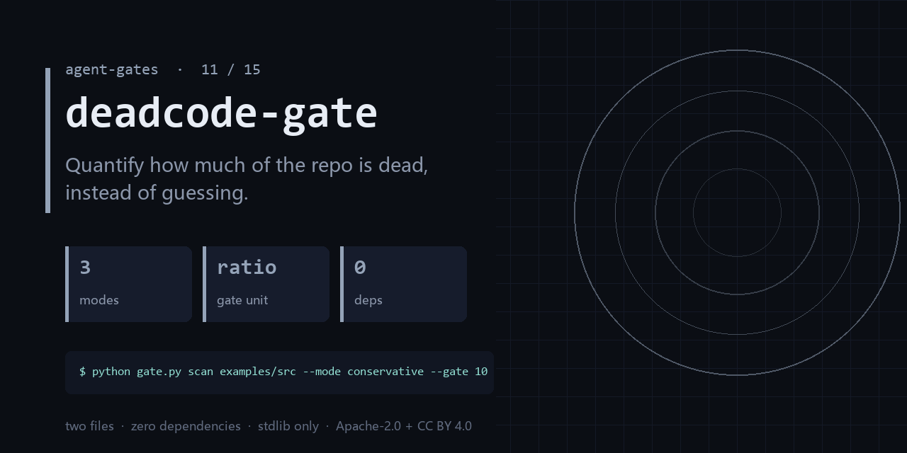

<div align="center">

</div>

<h1 align="center">deadcode-gate</h1>

<p align="center"><b>Quantify how much of the repo is dead, instead of guessing.</b><br><sub>one file · zero dependencies · stdlib only</sub></p>

<p align="center"><a href="https://github.com/chenhz01/deadcode-gate/actions/workflows/gate.yml"></a>   </p>

---

## The failure this catches

- Nobody deletes anything, because nobody is sure it is still used.
- Every refactor re-reads the same set of zombie functions.
- 'About 20% of this repo is dead' — where did that number come from?

One command, on a file you already have:

```bash
python gate.py scan examples/src --mode conservative --gate 10
```

<details>
<summary><b>Real output</b> — produced by the bundled <code>examples/</code>, not a mock-up</summary>

```text
examples/src/app.py:5: dead function 'never_called' (~2 loc)
dead: 1 defs, 2/14 loc (14.3%) [mode=conservative]
```

</details>

## What it does

- Counts definitions with no static reference, minus entrypoints and dynamic hints.
- Three modes: conservative / balanced / aggressive, so you choose the false-positive rate.
- `--gate` turns the ratio into a CI budget instead of a one-off report.

## What it does **not** do

- It cannot prove a symbol is unused — reflection, string dispatch, and plugins defeat any static tool.
- Conservative mode deliberately under-reports. That is the point.
- It does not delete anything.

Being explicit here is cheaper than a wrong expectation later.

## Exit codes

`0` = dead share under `--gate` percent. `1` = over it. `2` = bad input.

## Install

```bash
git clone https://github.com/chenhz01/deadcode-gate
cd deadcode-gate
python gate.py --help
```

Python 3.9+. Nothing to `pip install` — stdlib only.

## Use it in CI

```yaml
- name: deadcode-gate
  run: python gate.py scan examples/src --mode conservative --gate 10
```

## Use it as a GitHub Action

`action.yml` is included, so you can call this repo directly as a composite action.

```yaml
# .github/workflows/gates.yml
- uses: actions/checkout@v4

- uses: chenhz01/deadcode-gate@v0.1.2
  with:
    # IMPORTANT: this path is inside YOUR repository.
    # The examples/ in this repo are NOT in your workspace — pass your own files.
    args: "scan path/to/src --mode conservative --gate 10"
```

Pin the tag (`@v0.1.2`) rather than `@main` — `main` moves.
Check [Releases](https://github.com/chenhz01/deadcode-gate/releases) for the newest tag; `v0.1.0` predates the
fix that makes a mistyped path fail instead of silently passing.

If you omit `args`, the action only prints help and exits 0. It raises a warning
annotation — quoting this gate's own correct usage — so a green check is never
mistaken for "it inspected my files".


## 中文速览

**死代码门** — 把「这仓里有多少死代码」从感觉变成一个数字。

- 不敢删，因为「不确定还有没有用」——于是永远留着。
- 每次重构都要把同一批僵尸函数重新读一遍。
- 「大概有 20% 是死代码」——这个数字从哪来的？没有人知道。

一行命令：`python gate.py scan examples/src --mode conservative --gate 10`

边界：It cannot prove a symbol is unused — reflection, string dispatch, and plugins defeat any static tool.

## The gates

| # | gate | what it stops |
|---|---|---|
| 02 | **[loop-gate](https://github.com/chenhz01/loop-gate)** | Find where your agent looped, before it burns another run |
| 03 | **[permission-gate](https://github.com/chenhz01/permission-gate)** | Score how much more your agent can do than it should |
| 04 | **[context-gate](https://github.com/chenhz01/context-gate)** | Measure what truncation deletes, before the model starts guessing |
| 05 | **[instruction-gate](https://github.com/chenhz01/instruction-gate)** | Two of your instructions contradict each other. This finds them |
| 06 | **[output-gate](https://github.com/chenhz01/output-gate)** | Before AI-written text ships, run the four checks it always fails |
| 07 | **[memory-expiry-gate](https://github.com/chenhz01/memory-expiry-gate)** | Give every memory a TTL, then prove the expiry semantics actually hold |
| 08 | **[drift-gate](https://github.com/chenhz01/drift-gate)** | When embeddings drift, retrieval quietly rots. Fingerprint it |
| 09 | **[price-gate](https://github.com/chenhz01/price-gate)** | Your cost model is only as good as the price table under it |
| 10 | **[complexity-ceiling](https://github.com/chenhz01/complexity-ceiling)** | Per-file complexity budgets that fail the build instead of the reviewer |
| 11 | **deadcode-gate** ← you are here | Quantify how much of the repo is dead, instead of guessing |
| 12 | **[docrot-gate](https://github.com/chenhz01/docrot-gate)** | Docs don't die at once. They rot one stale command at a time |
| 13 | **[leak-gate](https://github.com/chenhz01/leak-gate)** | Scan for internal detail before the doc leaves the building |
| 14 | **[backup-gate](https://github.com/chenhz01/backup-gate)** | A backup you have never verified is a rumor |
| 15 | **[trail-gate](https://github.com/chenhz01/trail-gate)** | Hash-chained agent audit trail — and it verifies its own chain |

## License

- Code: **Apache-2.0** — see [LICENSE](LICENSE)
- Docs and example data: **CC BY 4.0** — see [LICENSE-SPEC](LICENSE-SPEC)

Attribution required when you redistribute the documentation; code can be used commercially
without a separate agreement. See [NOTICE](NOTICE).
